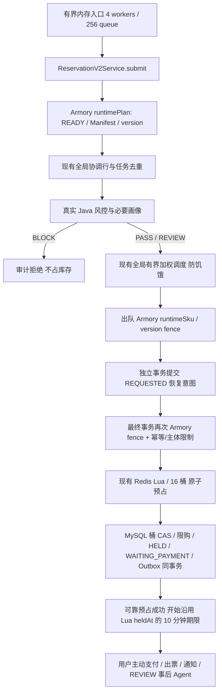

# 有界异步抢票入口（2026-10-29）

## 返回点与可靠性

以前：HTTP → 身份/参数 → Armory → MySQL 全局协调行与 EVALUATING 落库 → 完整 Java 风控 → 持久优先级入队 → HTTP 返回。

现在：HTTP → 原有 Redis 登录身份读取/续期、参数与用户一致性校验 → 实例内令牌桶/用户在途上限 → 有界执行器 execute 成功 → **202 requestId**。

202 文案：**已收到请求，正在尝试处理；不代表可靠受理或抢票成功。**

HTTP 线程只计算请求指纹和复制参数，不查询 MySQL、画像、Armory 或库存。显式 AbortPolicy；没有 CallerRunsPolicy，没有 @Async 自调用。仅执行器提交成功或本机已有同参数在途任务才能返回 202。`newSubmission` 区分新提交与重试回执，拒绝返回 429/503。

后台调用链：



本轮不改 Lua、库存事务边界、连接池、已有调度线程池或版本锁。三处 Armory 边界保留：后台 admission 选择版本；prepare 在装配共享锁下提交恢复意图；reserve 在装配共享锁内重新验证并持锁到事务提交。Manifest 静态快照与动态库存扣减仍分开。

持久 EVALUATING 与全局协调仍复用，但已全部移到后台。它们不再是 HTTP 回执的保证条件。没有为了入口 QPS 删除库存、订单、限购或版本保护。待审的“保护行初始化移出全局事务”补丁没有混入本轮：恢复 create 内原位置；原始工作区完整归档在 `.tmp/async-ingress-20261029_064647/starting-worktree.zip`。

## 查询与重试

`GET /api/tickets/reservations/by-request?requestId=...&receivedAt=...`

- 请求编号为稳定幂等键，重试必须带原用户、场次、SKU、数量和设备；后台仍用数据库唯一约束、指纹、恢复意图及 Lua marker 避免重复扣减/订单。
- 先查共享 MySQL 的真实任务/订单结果，再回退本机临时状态。任何节点都能查持久结果。
- 本机内存队列只在本实例可见。其他节点或重启后的缺失是 UNKNOWN；超过原始等待预算为 UNCONFIRMED，二者都 `terminal=false, authoritative=false`，不宣称失败。
- `receivedAt` 是客户端保存的首次点击时间提示，仅限制自动等待，不授权库存操作。客户端重试不能延长原自动等待预算。
- 120 秒是停止自动轮询的预算，不是“此后绝不成功”的取消承诺。已经进入持久调度的任务仍可能稍后完成；此时保留原 requestId 查结果或查订单。内存队列与持久队列分别有界、分别过期，整体延迟可能超过单个队列等待上限。
- 缺失、临时错误或状态读取忙时不生成失败结论；默认等待 120 秒后停止自动轮询，用户可用原编号重试/查看订单。只有持久结果 `reservationSuccess=true` 且有 orderId 才显示抢票成功。
- 查询有实例级令牌桶与 2 个并发数据库读取额度；忙时返回 STATUS_BUSY，避免轮询占满 Hikari。
- 已持久调度仍是共享 MySQL 全局权重（PASS:REVIEW=2:1，REVIEW 老化 2 秒，库存工作额度 4）。新内存入口是实例内 FIFO，不宣称全局优先级；多实例总内存容量和入口限流是实例数量的倍数。

## 故障边界

预占前的纯内存请求可以丢失，不逐条记录/恢复。正常仍执行真实业务，不主动丢弃已提交任务；有界等待过期的未执行任务被计数并跳过。

一旦 Lua 产生副作用，之前已提交的 REQUESTED 意图、持久任务、reservationId/orderId、版本与 owner 都可用于重放或补偿。保留 abort 墓碑、租约恢复、Lua 幂等、数据库库存 CAS、限购、订单/支付状态机、Outbox 和消费幂等。MySQL 提交结果不明时不能盲目返库存。

## 复现

```powershell
$env:JAVA_HOME='C:\Program Files\Java\jdk-21.0.11'
$env:PATH=$env:JAVA_HOME+'\bin;'+$env:PATH
mvn -f E:\credit_risk\ticket-risk-platform\pom.xml package '-Dtest=*Test,!InventoryCasMysqlConcurrencyTest'
cd E:\credit_risk
.\performance\run-reservation-v2-tests.ps1
.\performance\run-async-ingress.ps1 -Suite faults
.\performance\run-async-ingress.ps1 -Suite multinode
.\performance\run-async-ingress.ps1 -Suite load -Duration 120 -Rate 10
```

使用 PowerShell 7；旧 Windows PowerShell 的 Docker Go template 引号处理不兼容现有 IT 脚本。测试只创建新 schema/用户并原子领取空 Redis DB；不执行 FLUSH、DROP、开发数据库迁移。脚本记录起始容器状态，只停止本次自己启动的服务，保留原本运行中的服务。新 Java 测试实例均只绑定 loopback，退出时清理自己的进程。

压测输出 `performance/results/async-ingress-<时间>/`：POST 原始逐请求数据、真实业务结果、Prometheus 前后快照、内存/持久积压采样、库存对账及故障证明。主指标 total_post_qps 和 submitted_qps 分列；可靠预占 TPS 独立，GET/支付/出票不合并到 POST。库存充足、用户/设备/IP/requestId 独立；真实规则未替换。

离线分析：`python performance/analyze_async_ingress.py <结果目录>`。同时给出所有 POST 与成功提交 POST 的延迟，防止快速拒绝拉低 P95；区分整个 cohort 排空 TPS 与 POST 发送窗口内的预占 TPS。原始请求日志不改写。`reservation.v2.entry` 现在表示后台 submit 耗时，不能再用作 HTTP 延迟。

Grafana 仅增加仪表盘面板，不改既有运行中 Prometheus 的 Java 目标。测试直接抓取独立实例的 `/actuator/prometheus`，不重启已有监控容器。测试关闭后台 jobs/MQ 与库存定时指标采样，保留真实 Armory、Java 规则、Redis 与 MySQL 持久化；因此这是入口/预占测试，不能据此宣称支付、出票、通知或整体履约容量。

160 请求只作冒烟。持续负载是有界试验，不是稳定容量认证；当前后台全局协调/风控/库存事务可能慢于入口。后台失败、过期和未确认请求必须连同 202 一起报告，不能用快速拒绝宣称业务吞吐提升。POST 开始到预占结果的延迟按 MySQL updated_at 估算：存在秒级截断，SQL 更新时间也早于最终 commit，所以这是秒级近似，不能作为精确 commit 延迟的 P99；可靠成功本身由提交后的状态读取确认。HTTP 延迟按客户端独立计时。

## 回滚

先设置 `ticketing.reservations-v2.accepting=false` 停止新请求，等待持久 EVALUATING/QUEUED/CLAIMED 与 REQUESTED 库存恢复意图处理完成，核对库存。纯内存且未预占请求可丢失，不能当作成功订单。

本轮没有数据库迁移或 Lua 协议变化。需要回滚入口时，从起始源码 ZIP 逐文件取回 Controller、Service、Mode、profile 与前端 EventDetail，移除新增 Ingress 及其测试，重建并验证；不要整库覆盖、git reset/clean/stash。保留当前已验证的库存恢复与 V2 状态机。保护行初始化的待审补丁单独保存在起始 ZIP，不随入口回滚自动启用。

本轮新源码、JAR SHA 与文件清单保存在 `.tmp/async-ingress-20261029_064647/`。测试 schema 与 Redis DB 保留以便复核；回滚不删除任何业务或测试数据。
