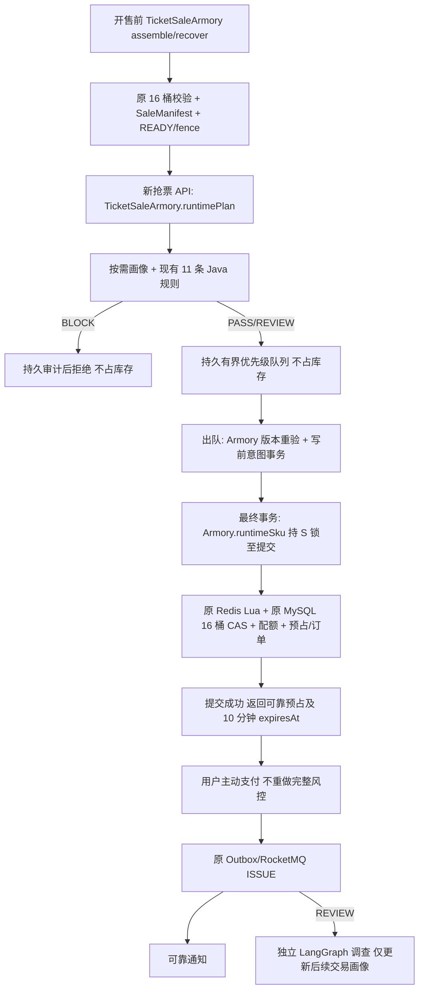

# 抢票入口 V2 实施记录

最新需求来源：2026-10-28 用户附件 c8f52dfd。完整 Java 风控仍在抢票阶段，支付不重复风控；取代上一条“支付前才做完整风控”的设计请求。

## Phase 1：实际基线与兼容边界

实际 POM 为 Java 8 target / Spring Boot 2.3.12，不进行框架升级。JDK 21 用于构建测试。2026-10-28 基线：110 tests，0 failures，0 errors，1 skipped；日志 `.tmp/architecture-rebuild-20261028/phase1-tests.log`。旧 JAR、源码 ZIP、原有 diff/status 均保存在该目录；不 reset、clean、stash，不提交既有修改。

旧链路：TicketController.reserve → 三次完整 Armory gate → risk.admit（特征、画像、11 规则）→ REQUESTED 意图独立提交 → Redis Lua + 16 桶 CAS/配额/订单/工作流/REVIEW 快照同事务 → AUTO_PAYMENT Outbox → Mock 支付 → ISSUE → REVIEW 的 RISK_CHECK。默认预占期限实际为 15 分钟。钱包支付仍调用 risk.fast。当前只有本地钱包/Mock 原子支付，没有外部网关回调协议；PAYING 仅允许转 PAID。

新链路：新 reservations API → 身份/轻量 READY/真实 Java 风控 → MySQL 可靠有界优先级请求 → 多实例带 lease/fence 调度 → 处理前 READY/强限制复核 → 原 Redis Lua 与 MySQL 桶事务最小落单 → 10 分钟期限 → 用户主动支付 → ISSUE → 独立通知/REVIEW 调查。风险优先级存请求，不增加订单风险状态。

兼容策略：旧 `/api/tickets/reserve` 和旧订单协议保留；新入口由独立开关启用，持久化协议版本。新订单不自动支付、不在支付时重查画像。旧请求、旧 15 分钟期限和旧消息按原协议处理；不将新 SQL 迁移自动应用到现有开发库。新状态属于新请求记录，不覆盖旧 tb_reserve_request 状态含义。

可靠性边界：202 只能在请求/决策/排队记录已提交后返回；不占库存，不启动支付倒计时。成功响应须 MySQL 预占/订单/桶分配均已提交。Lua 成功后提交失败/不明不得盲目补库存；意图行锁、持久终态、Redis tombstone 和库存 epoch 共同约束恢复。库存缓存缺失需关闭/显式恢复，不能自动填初始库存。

调度使用数据库持久任务及全局调度锁协调，队列总容量与 worker 均有界；PASS 倾斜、REVIEW 老化/保底，不承诺 PASS 必得库存。队列等待期限与 10 分钟支付期限分离。配额和恢复不得依赖 JVM 内存队列。

阶段验收：每阶段先运行相关测试，记录实际结果再进入下一阶段。生产代码改动、迁移、键协议、故障矩阵及性能实测将在下列阶段逐项追加。最终性能须保留旧 JAR对照，充足库存、真实规则、混合决策、成功预占 TPS 与 202 接受 QPS 分开，不以售罄快速返回制造提升。

## 三次旧 Gate 的并发边界与新流程对应关系

| 旧调用 | 实际保护范围 | 新入口必须保留的等价边界 |
|---|---|---|
| TicketController → admissionPlan | 独立短事务：读取 READY/active_version，S 锁只保持到准入快照返回；不是最终扣减授权 | 点击抢票时 runtimePlan 取得当前不可变策略版本。风控和排队不占库存。持久队列记录该版本；不能凭它直接扣库存 |
| ReservationIntentService.create → assertCanCreate | REQUESTED 插入事务内 S 锁，阻止装配/恢复 X 锁越过尚未提交的意图；恢复明确检查未决 REQUESTED | 出队后在创建写前意图的事务内重新验证版本/READY，并将相同版本与请求绑定；若版本已变，拒绝旧队列请求。尚未扣库存的队列记录无需变成有效订单 |
| ReservationTransactionService.reserve → assertCanReserve | 与意图 FOR UPDATE、Redis Lua、桶 CAS、配额及订单同事务；S 锁一直保持至提交，且与 admission.saleVersion 比较 | 最终库存事务内 runtimeSku 再查当前 READY/版本，S 锁到最终提交；只读取一次静态 SKU 并复用，不 SUM 库存。保留原桶 CAS 与分配约束 |

三次校验之间都存在其他事务可执行的空隙，不能用入口校验替代后两次。当前没有删除任何旧 Gate 调用。新运行时入口是 TicketSaleArmory 内的方法，复用同一 assembly/version/manifest/fence 表、键、TransactionManager 和恢复屏障，不是另建库存系统。优化对象是重复完整校验和解析，不是这些事务边界。

静态/动态区分：装配时验证 SKU 集合、总桶数/容量、配置、策略、不可变 manifest；运行时逐次检查 DB READY/版本、Redis 原字节及 fence/键存在性、时间/状态；最后事务再比较一次当前静态 SKU。动态剩余量由原 Lua、MySQL 桶 CAS 与分配记录决定，不能从 manifest 或 SKU 投影推断可卖库存。

Phase 2 已新增有界的 manifest 解析缓存：每次仍读取 Redis 字节，缓存命中也比较 DB 摘要，缺失/篡改不能被缓存掩盖；新增 runtimePlan/runtimeSku，旧三 Gate 保留。runtimePlan 不查 SKU 或 SUM；runtimeSku 在调用事务内单次查静态 SKU并验证元数据。现有 publish/recover 完整校验未删。

Phase 2 第一批相关测试 12 项全部通过，日志 phase2-tests.log；包含字节篡改/缺失/错版与缓存容量、配置事务边界、落单回滚。将补充 runtime gate 拒绝路径后进入下一阶段。

## Phase 3–7

Phase 2 补充运行时拒绝路径测试 7 项全部通过，日志 phase2-gate-tests-retry.log。首轮失败是测试夹具 saleStart=0 反序列化为 Integer，而实际静态元数据使用 Long；修正为真实销售时间戳后通过，没有放松生产校验。

Phase 3 第一批测试 23 项全部通过，日志 phase3-tests.log。V105 新增按用户历史摘要、已知支付设备及持久失效事件。订单插入/状态迁移、支付/退款记录与失效事件同事务提交；摘要重建按用户数据库行锁串行，多实例不会旧结果覆盖新结果；仅标记快照内读取到的事件 ID，不能用 MAX(auto_increment) 假定提交顺序。并发未处理变更/摘要过期/缺失会真实重建或回源，数据库失败不能默认 PASS。缓存未命中合并有 32 并发上限及 5 秒等待界限。默认关闭，迁移仅针对新测试库后启用。

实际旧规则使用累计订单比例和“最近 30 条”支付失败，而不是最近 30 天。此处保留这些语义，不把无限累加伪装成滚动 30 天；最近频率仍由现有 Redis 时间戳滑窗淘汰过期数据。摘要 30 秒强制重建，源变更持久事件会提前使其失效。未加入或改变 11 条规则及阈值。

新增 USER/DEVICE/IP 单批权威查询方法供 V2 使用，不把旧 PASS Redis 值当作当前 BLOCK 权威；最终预占还需与画像写入建立事务 fence（Phase 4）。旧 resolve 兼容入口暂保留。历史摘要是统计优化，不取代实时黑名单和强限制。

Phase 4 首批 16 项离线测试通过，日志 phase4-tests-retry.log。包含持久队列容量/全局并发边界、双调度实例不重复领取、PASS 权重与 REVIEW 老化、同场次重复点击别名、旧租约不能覆盖新裁决、画像 BLOCK 与预占授权的 SQL fence。全部三次旧 Gate 未删除；V2 三个边界仍经 TicketSaleArmory。真实 MySQL/Lua 用例 ReservationV2IT 已添加，但当前 Docker Engine 未运行，尚未执行，不能据此宣布真实链路通过。

V106 增加调度配置/任务/审计/请求别名及画像 guard。队列入列、租约和权重均在数据库协调，不把 JVM 队列当作可靠性来源。全局并发和容量由数据库设置约束，节点配置不一致启动失败。REVIEW 老化后仍与 PASS 交替，不能反过来饿死 PASS。原 Lua 增加可选 V2 参数；旧调用参数与旧结果码保留。V2 在 Lua 真正扣减时记录 Redis 服务端 heldAt/expiresAt，固定差值 600000ms；排队无期限字段、无库存扣减。

异常补偿新增 ABORTED tombstone，防止意图被判失败后迟到的 Lua 命令重新扣库存；原库存桶表、CAS、配额、分配记录和恢复机制复用。补偿先锁任务再锁意图；未知提交不能在未锁定持久状态时盲目加库存。仍需真实 MySQL/Redis 故障与多实例验证。

2026-10-29 Phase 4 完整离线回归：128 tests，0 failures/errors，1 skipped（phase4-all-tests.log）。真实 MySQL 8.0.32 / Redis 7.2 集成：ReservationV2IT 6 tests 全部通过，日志 `.tmp/reservation-v2-it-20261029_010210/tests.log`。验证 PASS/REVIEW 可靠预占、BLOCK 不改库存、排队不占库存、Lua heldAt/expiresAt 精确 600000ms、缺 manifest/出队版本切换拒绝、MySQL 配额失败回滚与 Redis 恢复/ABORTED 重放拒绝。

真实测试暴露并修复了摘要锁占位时间 epoch=0 在 MySQL TIMESTAMP 非法的问题；延长测试夹具的开售前装配窗口。未放松 Armory 安全限制。此前失败日志和测试库保留，不算通过轮。测试使用新建专用数据库及 V2 Redis 逻辑库，开发库未迁移/清空；本轮启动的 Redis 已停止，MySQL 保持用户测试前的运行状态。

Phase 5 本地支付/超时/旧支付兼容测试 20 项通过（phase5-tests-retry.log）。冻结已提交预占的 PASS/REVIEW 资格，钱包支付不再完整风控；新 Mock 默认禁止，必须显式开启。SQL 支付起始 CAS 同时校验状态、版本与数据库时间期限；V107 保留原期限并把预占/订单 expires_at 升为毫秒精度。PAYING 被通用 expire 明确排除，不因今后增加状态机边而盲目释放。

Phase 5 网关协议测试另 14 项通过（phase5-gateway-tests.log，含钱包/状态机相关测试）。V108 记录跨通道幂等编号与持久支付尝试。网关 HTTP 不跨数据库事务；UNKNOWN 保留库存，确认 CLOSED/FAILED 后才能释放或回到原期限内待支付。有效支付可晚到确认；已关闭/已释放订单不复活，迟到资金进入可重试退款；旧失败尝试的晚到成功不能关闭当前合法支付。重复回调/退款、金额/币种/商户编号、HMAC 回调认证分别校验。

真实网关未由用户指定，HTTP 适配器默认关闭，不冒充已对接银行/支付平台。启用必须配置 HTTPS（本机测试可 loopback）、独立凭据及至少 32 字符回调 HMAC key。提供方须保证 merchantPaymentId 幂等、原 expiresAt、查询结果可追溯、按商户编号关闭会拦截迟到 CREATE、refundRequestId 幂等；否则保持 UNKNOWN/人工对账，不能假定未支付。当前可验证的完整付款渠道是本地钱包；网关故障测试使用受控适配器。

Phase 6：Java 全量回归 142 tests、0 failures/errors、1 skipped（phase6-all-tests-retry.log），前端 npm build 通过（phase6-web-build.log）。真实 MySQL/Redis 增补集成 8 tests 全部通过（`.tmp/reservation-v2-it-20261029_023821/tests.log`）：通知事务回滚不影响已出票订单、独立重试/重复消息不重复通知、迟到预占审计不回退 ISSUE 工作流、Agent 不在事务内执行、画像后续 BLOCK 只拒绝新交易，另一笔先前已提交的资格仍可支付出票。

Phase 7 恢复审计发现并修复：Armory 显式恢复原来只重建旧标记字段，V2 的 protocolVersion/heldAt/expiresAt 会丢失。现在从已提交预占的数据库 expires_at 重建原精确期限，发布恢复版本，不增加库存、不延长期限。新增真实专项测试通过（`.tmp/reservation-v2-it-20261029_024605/tests.log`）。补充新操作固定标签 Micrometer timers；phase7-build-tests.log 的 142 tests 全部通过，1 skipped，JAR 与测试专用纯库存启动器构建成功。

纯库存性能替身仅位于 src/test，不进入生产 JAR，仅允许绑定本机、使用 credit_risk_v2_bench_ 专属库和 26379 测试 Redis。真实 B/C 不启用该替身，保留原规则阈值。性能 A/B/C 正在验证，不能提前宣布性能达标。所有示例权重仅为测试参数，不作业务固定值。

完整运行/迁移/回滚说明见 [RESERVATION_V2_OPERATIONS.md](RESERVATION_V2_OPERATIONS.md)。没有提交原有未提交成果；原工作树源码快照与预先修改补丁保留在 `.tmp/architecture-rebuild-20261028`。旧源码已在隔离 target 重新构建为 baseline-built.jar，避免用来源不确定的历史 JAR 冒充本轮基线。
