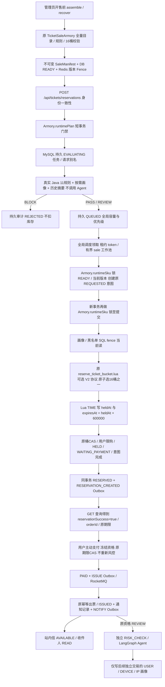

# Reservation V2 手动启用、并发边界与回滚

本批是在实际 Java 8 / Spring Boot 2.3.12 工程上增量改造，不升级框架，不改为新的库存系统。默认不启用 V2；本批没有迁移原开发数据库。

## 调用链



HTTP 202 只证明排队任务已可靠受理，不证明成功预占；GET 的 `reservationSuccess=true` 才代表 MySQL 预占事务提交。队列等待没有库存扣减，没有支付期限。不能把受理 QPS 当成成功预占 TPS。

曾试验本机受理并发约束，但未证明抢票POST QPS改善，已回退。对应实验源码/JAR和原始结果独立归档，不作为默认优化；数据库全局容量、公平性与可靠性约束继续保留。

## 三个旧 Gate 的保护范围

1. `admissionPlan`：短事务获取 READY、不可变策略与当前版本，供本次风控使用。事务结束后不构成任何库存授权。
2. `assertCanCreate`：在原意图事务中持有场次装配共享锁直到 REQUESTED 提交，恢复过程可以发现尚未解决的请求。
3. `assertCanReserve`：在最终库存事务中锁住同一装配屏障直到 Lua、桶 CAS、限购、订单一起提交，阻止恢复或换版跨越库存提交边界。

旧三个方法及调用全部保留。V2 对应为 `runtimePlan`、prepare 中 `runtimeSku`、reserve 中 `runtimeSku`。第二和第三边界仍分开；出队不得复用入队前校验结果。两处 runtimeSku 不 SUM 库存，复用静态 SKU；原 full gate 和 assemble/recover 仍执行完整库存校验。manifest 解析缓存每次比较 Redis 原字节及 DB digest，不掩盖缺失、篡改或换版。

## Redis / MySQL 恢复协议

持久任务先于意图，意图先于 Lua。JVM 可在任何一步退出：租约到期后新 token 领取，锁任务与意图后确认持久状态，已完成记录绝不补偿。仅 Redis 成功而 MySQL 未完成时，重试复用同一 reservationId / 指纹及原 Lua 期限，或者补偿为 ABORTED。即使标记尚未出现，补偿也写 tombstone，阻止迟到的旧 Lua 命令重新扣库存。MySQL 不可用时保留持久租约等待恢复，不能盲目加库存。

缺失库存、manifest 或 fence 安全拒绝；普通请求绝不回填初始库存。显式恢复仍通过原 Armory RECOVERING 屏障、订单/库存锁、桶分配及限购权威核对。V2 恢复标记从已提交预占的 expires_at 重建 heldAt/expiresAt，并写入恢复版本，不能延长支付期限。

## 调度与支付边界

调度协调行只串行化容量、领取和 PASS/REVIEW 选择；库存事务不持有该全局锁。节点容量/并发/权重/老化配置不一致启动失败。默认 PASS 权重2、REVIEW老化2秒，均为可配置调度参数，不是风控结论。REVIEW 不抢占执行中的 PASS，过期任务没有资格开始新扣减。租约接管以新 token 和行锁隔离旧执行者；JVM 内线程池有界，不作为可靠队列。

支付资格来自已提交的 PASS/REVIEW，不调用 Agent 或重新完整风控。钱包支付和超时通过订单行锁、版本 CAS、数据库时间以及唯一支付记录互斥；库存释放仍由原释放状态与桶分配幂等保护。PAYING 不由通用超时任务直接释放。

外部网关默认关闭。启用前必须验证提供方 merchantPaymentId 幂等、查询、关闭可拦截迟到 CREATE、退款幂等及签名协议。UNKNOWN 保留库存等待对账；已关闭订单收到资金只退款不复活，不出票。没有指定真实提供方，本批受控适配器测试不等于真实资金平台验收。

## 数据库与 Redis

在备份且核对已有 V102–V104 后，由部署流程显式执行 V105–V109，禁止把 fresh `schema.sql` 直接覆盖已有库。V105 是历史摘要/失效事件，V106 是持久调度/审计/请求别名/画像 guard，V107 提升订单与预占 expires_at 精度，V108 是支付尝试和跨通道幂等，V109 是可靠站内信。迁移文件是人工发布输入，不能假定应用已自动迁移。

库存 Key 保持 `ticket:{sku}:stock:bucket:0..15`、原用户计数/预占标记/pending；场次保持 `ticket:sale:{session}:manifest:vN`、active-version、publication-fence。V2 标记增加 protocolVersion / assemblyVersion / heldAt / expiresAt。没有第二套库存计数器。

## 启用与回滚

1. 所有节点先部署支持 V2 与 guard 的版本，完成迁移与真实测试；旧二进制不支持新画像 fence，不允许混跑写画像。
2. 管理员使用原装配接口发布 READY；在 IDEA 手动增加 profile `reservations-v2`，设置当前独立 MySQL/Redis/MQ 连接。网关默认关闭，Mock 自动支付默认关闭。
3. 前端通过 `/api/tickets/reservation-mode` 选择新入口，稳定 requestId 和 reservationId 支持刷新后继续查询；排队中不能显示支付成功或开始倒计时。
4. 回滚先设 `ticketing.reservations-v2.accepting=false` 停止新受理，保留 V2 调度、补偿、支付、通知与调查能力直到在途任务结清。V2 开启时禁止同时开放旧接口的新受理，旧请求查询、重放与已有订单支付继续可用；A/B 使用不同专属测试库。
5. 结清/对账所有 V2 REQUESTED、CLAIMED、HELD、PAYING、UNKNOWN 和待发送 Outbox 后，才能关闭 V2/摘要开关、重新开放旧受理或回退旧二进制。数据库新增表和数据保留，不 DROP，不回退精度，不删除 Redis tombstone。补偿前同时核对 requestId、fingerprint、reservationId、orderId；发现旧链路碰撞或损坏意图保留现场，不补偿另一笔订单。

所有开关须在全部节点一致设置。回滚不是清空 Redis 或把库存重新设置为总库存。

## 可复现验证

```powershell
cd E:\credit_risk
.\performance\run-reservation-v2-tests.ps1
.\performance\run-reservation-pipeline-benchmark.ps1 -Suite B
.\performance\run-reservation-pipeline-benchmark.ps1 -Suite A
.\performance\run-reservation-pipeline-benchmark.ps1 -Suite C
```

脚本只在主动执行时运行。自动选择空的专用测试 Redis 逻辑库，创建新的 credit_risk_v2_* MySQL schema，保留所有原始日志和数据库。结束仅停止脚本启动的项目服务。纯库存 A 的风险替身在 `src/test/java/benchmark`，不进入生产 JAR，且仅允许隔离本机测试连接；B/C 不使用该替身，保留原规则阈值并使用每用户独立 loopback 源 IP。

Prometheus 开发目标仍为18082；压测18083/18084/18085直接保存 `/actuator/prometheus` 前后快照，不声称开发 Grafana 已采集压测实例。新增 reservation-v2 仪表盘复用 ticket-prometheus 数据源；timer 有包含关系，禁止相加，队列均值不是 P95。抓取读取内存指标，不在抓取回调中查询业务表。
