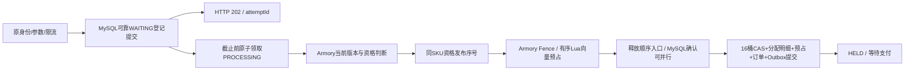

# 阶段E/F：16桶向量预占与统一验收

## 保留的主链

B的5秒截止只裁决WAITING，PROCESSING靠技术超时与租约恢复；C的同SKU序号只串行到Lua turn提交，不等待前序MySQL确认；D的长期画像/REVIEW缓存逻辑不改。没有全局串行化不同SKU，也没有删除三处Armory校验。

## 跨桶协议

旧协议2、旧单桶Lua和旧分配表头保留。新增协议3使用相同的21个同SKU hash-tag key，Redis单实例已验证；Lua对16个可用桶、累计限购、单次限额、幂等指纹、版本及关键key类型先全部验证，再一次性扣减。总量足够时允许跨桶组合，总量不足不发生部分扣减。总量为0和总量正数但不足本次数量分别返回SOLD_OUT、INSUFFICIENT_STOCK。

marker记录固定16分量、quantity、协议版本、装配版本、heldAt及原expiresAt；支付期限由实际Lua成功开始600000ms。MySQL确认将相同向量按桶号排序CAS，并在同一事务写header、item、预占、订单和Outbox。header的bucket_id=-1仅表示向量，真实桶号在item；不是将库存重新集中到一个热点行。

Lua前保留原可靠恢复意图。Lua成功、SQL失败或进程中断时，原幂等marker与意图参与恢复/补偿；释放按marker协议分派，SQL released裁决和Redis状态转换均幂等。关闭向量开关后的兼容代码仍能释放既有协议3订单，不能退回不认识协议3的旧二进制。

Armory恢复从有效订单/权威分配明细重建16桶消耗及marker，保持原支付到期时间；向量缺失、和不匹配、版本不一致均安全拒绝。READY配置绑定reservationProtocol和singlePurchaseLimit，防止混合实例无意启用新协议。

## 单次限额与迁移

V113为附加迁移：SKU单次限额默认100，dispatch持久模式位默认0，新建allocation_item表。不改已售库存、旧主键或旧分配数据。schema.sql仅为全新库结构。未将迁移应用到现有开发库。

新增管理员配置入口只在向量兼容模式下允许使用，要求首次装配前、未开售、无预占意图，并经装配状态与SKU锁保护；值1至100。限额以SKU配置，其所属场次隔离，没有新增场次级默认值继承。

## 售罄并发

只有真实Lua确认16桶可用量为0才产生本机有界提示；不是永久SKU售罄锁存。后台每次最多2个SKU、每SKU8项，复用原调度控制线程，不新增业务线程池。MySQL锁使用SKIP LOCKED避开正在原子预占的任务。

每项在Armory版本屏障和任务锁下重新用Lua检查0库存，再写该attempt墓碑。释放先发生则不清理；墓碑先发生则释放不会复活该attempt。HELD marker、已完成Lua turn、HELD/待支付/PAID订单不受清理。WAITING截止先按B裁决。已发布但非队首的序号必须先墓碑、再由原恢复路径安全推进，禁止留下序号空洞。

提示丢失只影响及时结束速度，不影响库存安全：实际worker仍执行原子库存校验。新库存只允许用户新点击建立新attempt。

## 部署及回退边界

vector-reservations默认false，要求可靠attempt与ordered-lua已启用且持久模式一致。所有实例先升级兼容代码，检查V113，再通过受控装配发布新READY；本轮不自动激活现有环境。

回退先停止该场次新接纳，排空/恢复PROCESSING及未决意图，核对16桶、marker、订单和分配，再经审核切回持久模式与应用开关、重新装配。保留item表和兼容释放/恢复代码，直到历史向量订单及退款窗口结束；不提供自动DROP或改写历史分配。源码回退必须使用E/F进入前快照，不能对大量未提交成果执行git reset。

## 验证范围和代价

L1验证向量CAS、回滚、幂等释放、限额与协议校验；L2使用专属MySQL/Redis验证碎片库存、售罄与释放竞态、Armory恢复、支付/超时/退款；F执行一次全量回归、条件集成、真正进程中断与双JVM恢复，最后统一六轮对照。外部支付和付费Agent不调用。

协议3每次额外读16桶并记录非零分配项；不会预先承诺性能改善。AB只隔离E开关，B/C/D保持相同开启，quantity=1、充足库存，不能解释为整套B至E相对旧链路的性能提升。原始失败、修复、条件跳过及冷启动技术超时均必须保留并在结果中列出。
