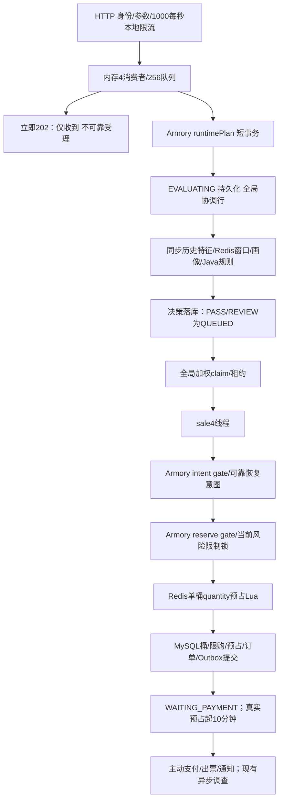

# 抢票主链路整改：阶段A审计与待确认迁移方案

本文保留阶段A的源码审计与设计。用户随后确认三项方案并收窄本轮为阶段B；B实施记录见ATTEMPT-PHASE-B-PROGRESS.md。阶段A时没有修改生产代码、执行数据库迁移、业务请求、容器操作或压测。下文C–F仍为设计，不能当成已经实现。

审计对象是ticket-risk-platform/src/main，而不是同仓库的credit-risk-platform、hmcredit-risk-platform或bin目录副本。Java和前端现有247个源文件/配置已按原样备份并记录SHA256于`.tmp/attempt-audit-baseline-20261030_080645`；工作区已有大量修改，没有reset、clean、stash、覆盖或提交其他人的成果。

## 一、真实链路及关键差异



|要求|真实实现/证据|整改影响|
|---|---|---|
|可靠attempt之后202|ReservationV2Controller.create→ReservationIngress.receive；先ThreadPoolExecutor.execute后返回。Work.run才backend.submit/create|必须改HTTP成功语义；202之前最小可靠登记，DB失败返回非202。不能继续复用原“不可靠接收”文案|
|5秒WAITING，仅领取前有效|Ingress wait-ms=120000；Dispatch queue-timeout-ms=30000；数据库初态EVALUATING|新增WAITING/PROCESSING协议，等待截止和技术租约分开|
|PROCESSING不被排队期限误杀|V2Transactions.prepare/reserve仍检查queue_expires_at；reserve_ticket_bucket.lua的ARGV[8]也检查该期限|只改Java枚举不够，Lua/恢复必须一并按协议版本修改|
|200ms批次屏障|V2只看到25ms轮询和每次最多4个claim；没有200ms资格凑批等待。application.yml的jobs.interval-ms=200用于Outbox等后台轮询|不能误删Outbox轮询；不把claimBatch误认为资格批次屏障|
|先完成资格先预占|Dispatch.claim/claimBatch有PASS权重、REVIEW aging；随后sale线程竞争，无同SKU资格就绪序号|取消权重作为新协议资格排序；新增每SKU顺序边界、多实例fence|
|长期画像决定PASS/REVIEW/BLOCK|classifyReservation主要按实时特征评分决定等级；findBlockingAuthoritative只保留BLOCK，已有长期REVIEW未单独驱动快复核|新增抢票资格服务，停止此入口调用完整历史评分；不改画像生成或其他交易的旧规则入口|
|REVIEW AGREE/REJECT短缓存|无此缓存；RiskProfileCache缓存长期画像，risk:feature:user快照也不是复核许可|新增独立缓存键、值和单飞控制；不得混用长期decision|
|不扫描长期历史|RiskFeatureService.collect→RiskHistorySummary.read；冷摘要同步REQUIRES_NEW重建订单/支付聚合，失败再回源|新抢票快速资格不得调用该collect；保留服务供其他原路径使用|
|quantity按SKU/场次配置上限|ReserveRequest只有限制1–100；TicketSku只有累计purchase_limit；Lua q原子校验但没有独立maxPerAttempt|新增配置、装配快照、Redis校验和管理/前端字段|
|quantity可可靠扣减|16桶Lua只从某一个桶取得全部q；StockBucketService.decrease和allocation主键也只支持一条分配|若跨桶购买须完整扩展分配/恢复协议；总和足够不代表当前实现能购买|
|明确售罄清理|Lua -3被转成SOLD_OUT；没有version/库存变化代次保护的WAITING清扫|先区分真实总量0与单桶不足；新加安全失效通知/条件清理|
|有限资源/负载背压|本地令牌桶1000/s、4/256、持久容量512、CLAIMED全局4；不看5秒能否领完|加入保守自适应接纳，保留硬上限；不能仅增线程或把超时当吞吐提升|
|前端5秒排队，处理中继续查询|App.tsx保存requestId与120秒waitUntil；终态靠authoritative/terminal，未知停轮询|新attemptId、server waitingDeadline、PROCESSING状态、终态后显式新点击生成新requestId|

真实入口队列是JVM ArrayBlockingQueue；持久优先级队列是MySQL tb_reservation_job，并未发现抢票Redis List/Stream入口队列。Redis pending是已预占的到期ZSET，不是待抢票队列。不能对不存在的Redis入口队列做“修复”。

## 二、已存在且应保留的正确性保护

1. 三个Armory边界：submit.runtimePlan在入库前验证READY/版本和Redis完整性；transactions.prepare.runtimeSku在可靠意图事务内持有装配共享屏障；transactions.reserve.runtimeSku在最终库存事务内再次持有屏障。恢复/重新装配用装配行排他锁，故排队前版本不能替代最终校验。
2. request_id唯一、fingerprint、active_owner唯一及request alias；job/intent/reservation/order稳定关联；最终lease token+状态校验、事务行锁；不重建订单系统。
3. Redis Lua原子限购、数量扣减与持久marker；abort_reservation_v2有无hold均写ABORTED墓碑，防止晚到命令复活；release只有HELD才回补，保留marker防重复释放。
4. REQUESTED意图先独立提交，最终Redis失败/MySQL失败可补偿；恢复锁顺序job→intent，COMPLETED不能被误补偿。
5. MySQL库存桶CAS、累计限购、HELD预占、WAITING_PAYMENT订单、COMPLETED意图、RESERVED job及RESERVATION_CREATED Outbox在同一事务提交；支付期限来自Lua TIME的heldAt+600000。
6. OrderService.expire排除PAYING；网关UNKNOWN结果继续对账，验证支付时间/资金凭证，晚到收款走退款；Outbox稳定业务键和消费幂等保留。不可因为新attempt终态或售罄，清理已HELD/已支付订单。
7. Redis缺配置/桶/版本仍安全拒绝，不能回填初始库存。parsed SaleManifest缓存仍绑定装配版本和digest。

当前reserve最终事务内有Redis网络往返，不能声称已经实现跨系统无事务等待。第一步保留可靠性桥，不先拆事务；若要把Lua移出最终事务，必须另行证明装配恢复、job租约接管、风险BLOCK fence以及补偿同时安全，不能当作本轮顺手重构。

## 三、目标attempt协议

目标仍复用tb_reservation_job，而不是新建独立订单/库存系统：新协议版本与旧2分开解释。

```
WAITING --合法领取--> PROCESSING --资格/有序Lua/确认--> RESERVED(对外HELD)
   |                       |
   +--QUEUE_TIMEOUT        +--RISK_REJECTED / SOLD_OUT / FAILED
```

SYSTEM_BUSY是登记前明确拒绝，不创建成功attempt；QUEUE_TIMEOUT必须有可靠终态记录；SOLD_OUT、RISK_REJECTED和基础资格拒绝各有明确resultCode。成功保留现有数据库RESERVED命名，以兼容ReservationPaymentPolicy；新HTTP响应明确映射attempt状态及orderStatus，不能改变支付订单状态机。

HTTP线程仅做必要身份/参数/资源/初筛、短可靠登记及响应，不做完整风险采集或等待库存事务。202包含attemptId（复用job.id）、requestId、state、waitingDeadline、查询地址及权威语义。数据库提交失败/结果未知不能伪造可靠202；客户端保留相同requestId查询/重试，不因网络超时创建第二单。

### 5秒领取与超时的线性化

- waitingDeadline采用数据库统一时基；WAITING排队期限是5秒，领取后不再用于处理/库存截止。
- 领取先按索引选择并锁定候选（MySQL SKIP LOCKED），锁定后用新的数据库时间判断并条件更新WAITING→PROCESSING；超时使用相反且互补的条件WAITING且deadline<=now。等于截止时归超时。两条路径必须只有一个成功。
- 不用在锁等待前预取的应用时间授权领取；单条UPDATE里NOW的求值边界也要经过真实MySQL锁竞争测试，不能只靠H2推断。明确成功领取时刻为持锁后的数据库状态转换，工作只能在该事务提交后开始。
- PROCESSING只使用技术租约、owner token、技术调用超时及恢复，不再让5秒或旧30秒队列期限杀死它。测试用可控Clock/数据库时间替身和事务屏障，不靠sleep。
- 超时清扫器延迟不会使晚任务合法：worker自己也必须做相同截止裁决。QUEUE_TIMEOUT无恢复可执行分支，不得回到WAITING。
- 相同有效attempt重复HTTP合并；终态attempt用原requestId重试仍返回原终态。显式新点击产生新requestId和新attempt；库存释放只提供新机会，不复活旧attempt。

### 入场和线程职责

保留现有线程数，先去掉“内存先排120秒、再持久排30秒”的重复等待。权威WAITING为MySQL任务，进程内只保留有界唤醒/执行提示，不再作为可靠接纳依据。HTTP只承担最小登记事务，历史聚合不迁到HTTP。领取数量不得超过可用工作槽，并保留跨实例上限。

接纳上界=min(硬容量、保守处理率×剩余5秒窗口+可用槽)，结合实际等待、Hikari等待/错误、Redis延迟/错误、池拒绝进行保守拒绝。吞吐估算冷启动不能使用未经测量的高默认值；多实例本地估算只作更保守的预拒绝，权威容量须由数据库原子协议控制。禁止在每次HTTP抓取大量数据库监控指标。系统繁忙与已登记后QUEUE_TIMEOUT分开计数。

## 四、严格资格顺序：实施前必须确认的边界与成本

资格就绪以“所有共同校验及必要复核完成后，持久化资格发布获得SKU序号”为线性化点，不能比较不同JVM的System.nanoTime。序号分配按SKU、装配版本隔离，保留到提交；这样序号与已发布资格顺序一致。PASS与REVIEW共用同一队列，没有绝对等级优先级，AGREE命中只减少额外复核，不获得插队权限。

|方案|顺序保证|吞吐/恢复成本|建议|
|---|---|---|---|
|C1：每SKU持锁到Lua+MySQL确认结束|资格发布序号→完整确认串行；其他SKU可并行|会串行化该SKU的16桶确认事务；当前确认事务曾有P95约722ms，不能承诺保留4工作线程的单SKU吞吐。该P95不能倒数当容量，但足以说明排队风险|只在明确接受该成本后采用|
|C2：每SKU持久资格序号+Lua原子消费序号，随后MySQL确认并行|按已发布序号取得Lua库存机会；后序MySQL可能先提交|需要扩展Lua顺序fence及跳过/失败墓碑、意图绑定、幂等重放、Redis缺失安全恢复。序号推进不能与扣库存分成两个可穿插的命令|推荐目标，但属于协议改造，不能把普通线程提交顺序当替代|

C2的关键要求：原子Lua内同时验证当前SKU/version/nextReadySequence并完成预占结果及序号推进；资格发布后崩溃不能留下不可跳过空洞。未发布序号的任务不进入该通道。租约重领保持同一序号/意图/订单；过时worker不能越过序号fence。失败/售罄/版本失效的槽位只有在确认没有库存副作用或已有幂等补偿墓碑后才可跳过。Redis顺序cursor丢失安全拒绝，不能重置为1；复用Armory恢复屏障，在排空/核对在途意图后恢复。普通释放不倒退或重开序号。

即使C2，先获得资格的任务在外部故障下也可能造成同SKU队首阻塞；技术超时触发恢复/补偿而非让后序静默越过。不同SKU独立推进，不得使用一个全局worker串行所有SKU。用户要求“如果严格顺序明显影响性能先报告权衡”，故该边界需在阶段C前明确，不能默选无序或承诺免费严格FIFO。

## 五、长期画像与REVIEW快复核

阶段D拟新增独立抢票资格服务，读现有JdbcRiskProfileRepository.findSubjects（三主体单SQL），不改RiskDecisionService.investigate/persist、RiskAgentClient、risk-agent、定时画像流程。用户补充后明确：Redis miss必须回源MySQL；仅MySQL确认画像确实不存在的新用户临时走REVIEW；数据库不可用或无法确认画像时安全拒绝，不能以默认REVIEW/PASS放行。过期记录不擅自等同于物理不存在，需要在D明确定义；不写回或升降长期画像。有效BLOCK必须拒绝且压过旧AGREE。

所有用户共用身份、活动/Armory、单次/累计限购、幂等、当前明确黑名单等校验；PASS不调用完整历史collect。最终风险guard当前读仍保留，确保资格形成后新增BLOCK不能越过尚未预占的grant边界。

### 真实可用的快复核数据

1. 已有Redis窗口Lua和稳定requestId，可构建独立极短窗口计数，不能去扫描历史订单。窗口/阈值必须配置和版本化；无配置不悄悄放行。重试复用同attempt事件ID。
2. 已有active_owner（user:session）唯一约束，可证明当前有效attempt所有权；同一有效attempt重试是幂等，不应被当作“冲突攻击”。没有发现真实会话并发注册表，不能假装可检测多个登录会话/指纹。
3. 已有明确risk:blacklist:device及tb_risk_subject_guard.blocked_until。这是即时强限制，必须作为所有用户的共同安全校验，不能只让REVIEW检查。未发现额外“可疑设备分值”数据源，不新造信号。

因此候选三条不能照单全做：第一条有实现基础；第二条只能复用真实attempt冲突语义；第三条现有强黑名单应下沉共同安全检查，不宣称已有额外设备画像。

### 短期缓存草案

键：`ticket:review:{SHA256(userId|sessionId)}:ctx:<SHA256(deviceId|ip|identityScope)>:rule:<quickRuleVersion>`。使用sessionId隔离同一活动不同场次；eventId作为值的校验字段，避免eventId/sessionId混淆。

值仅有AGREE/REJECT及profileVersionVector（三主体type/value/id/version/有效期的摘要，包含无记录标记）、quickRuleVersion、assemblyVersion、createdAt、expiresAt、上下文摘要及sourceAttemptId。不是长期画像决策，不写tb_risk_profile。

建议AGREE默认最多30秒，最终TTL=min(配置TTL、SKU/场次开售窗口剩余、有效画像剩余有效期)；REJECT记录同样有界但永不作为下一合法新attempt的自动拒绝依据。同attempt已持久裁决先复用，不重复复核。

查缓存前仍读权威当前画像版本和共同黑名单；BLOCK立即拒绝，版本/规则/装配/设备/IP或身份上下文改变则AGREE失效。缓存故障REVIEW不得默认放行，记录技术失败并走有界恢复/明确终态。新attempt遇旧REJECT重新复核并覆盖结果。

不同attempt穿透用短TTL的SET NX token单飞，只有持有token者可条件删除/发布；禁止阻塞sleep、Future.get或持锁跨MySQL事务。未获单飞的任务有界让出执行机会，不延长业务期限，也不按PASS放行。必须验证锁过期后旧持有者不能覆盖新结果。

## 六、quantity和售罄的协议范围

独立配置max_per_attempt（每SKU；场次可提供默认），与累计purchase_limit分离，写入Armory manifest、digest和Redis config；Java初筛及Lua最终都校验，不只前端限制。

当前只有一个bucket_id和allocation头记录。两种实际选择：

- 保持单桶：安全但必须返回“本次quantity无法满足”，不能把碎片不足当整SKU售罄；单次上限不能假定总库存足够就能购买。这限制业务能力。
- 原子跨桶（推荐）：保留16个现有库存桶及allocation头，新增每reservation/bucket分配明细，Lua一次计算并原子扣多个桶；MySQL按固定bucket顺序CAS全部分配，失败整体回滚。release/abort、OrderService复用的restore、Armory recovery必须全部识别分配向量；旧单桶marker继续兼容。不是新库存系统，但属于版本化库存协议升级。

新增明细不能仅增加一张表就宣称完成。已产生多桶订单后，旧二进制不知道如何释放这些分配，不能通过关开关直接安全回滚。必须先部署兼容读/释放/恢复，再启用新写；回退保留兼容桥，不删除已售分配记录或重置Redis库存。

真实售罄需在Lua中区分全部可用库存0与quantity不足，并带assemblyVersion和库存变化generation。任何释放均推进generation；迟到的售罄通知不能清理新generation已接纳任务。清理只能命中同SKU/version/generation的WAITING和尚未进入有效预占阶段的PROCESSING；与预占意图创建/执行互斥。已存在意图或hold marker的不批量改失败，交正常预占/恢复裁决。HELD/WAITING_PAYMENT/PAID及旧终态均不动。恢复库存只允许新点击形成新attempt。

## 七、受影响文件（计划，不是已修改）

|模块|文件/新增类|作用|
|---|---|---|
|API/前端|ReservationV2Controller、ReservationModeController、ReservationIngress、ticket-risk-web/src/App.tsx|可靠202、attempt查询、新点击/重试区分、排队/处理中/终态UI|
|生命周期|ReservationDispatch；新增AttemptClock/AttemptLifecycle或等价小组件|WAITING→PROCESSING/QUEUE_TIMEOUT、数据库时间边界、幂等和有界接纳|
|调度|ReservationV2Service、ReservationDispatchScheduler；新增SkuReadyOrder|取消新协议权重，空闲槽claim、按SKU资格发布、技术租约、唤醒/恢复|
|资格|新增ReservationEligibilityService/QuickReviewService|长期画像快读、共同校验、轻量复核；不调用历史collect或Agent|
|复核缓存|新增ReviewPermitCache及token条件发布/释放Lua|AGREE/REJECT、TTL/版本/context校验、短期单飞|
|最终交易|ReservationV2Transactions、ReservationRuntimeRecovery、ReservationRecoveryService|PROCESSING无排队截止误杀、恢复意图/lease、已有库存副作用的安全恢复|
|库存|InventoryService、StockBucketService、ReservationIntent、对应Intent/Inventory repositories；reserve_ticket_bucket/abort/release Lua|quantity独立上限、可选跨桶分配、顺序fence、补偿/恢复；保留旧协议|
|装配/配置|TicketSku、CatalogAdminService、SaleManifest、TicketSaleArmory、schema.sql及版本迁移|单次限额进入静态快照和READY校验；序号/新marker恢复|
|监控/测试|现有Micrometer业务指标；相关ticket/sale/inventory/payment并发测试与隔离负载脚本|新阶段/拒绝原因与真实HELD吞吐；不开发通用Harness|

订单状态机、Outbox/MQ业务键和支付资格策略原则上保留；若引用job状态则只做必要兼容。Agent、LLM、Python、画像生成/调查逻辑和无关项目均不在修改范围。

## 八、数据库草案与迁移/回退

DDL草案见同目录`attempt-migration.sql.draft`，不放入自动迁移目录，也不执行。建议只添加列/索引/辅助明细，不重建现有库存主表、不改allocation原主键、不更新已售数量。

部署步骤：保存当前源码与构建→兼容代码和离线测试→独立测试库应用DDL→真实Redis/MySQL并发测试→版本化启用新请求协议→验证指标。正式环境必须先暂停旧接纳并排空/核对旧未完成jobs及意图，确保所有实例都理解新状态、marker和分配；旧实例的恢复服务不认识PROCESSING，混跑会误判活动任务，不能滚动盲切。

已有HELD/已支付订单不迁移、不重算、不删除。新协议关闭后停止新接纳，排空WAITING/PROCESSING与补偿，再保留兼容释放/恢复版本处理已生成的新协议订单。DDL扩展先保留；只有确认无任何新协议订单、marker、意图引用才可另行审核删除列/表。不能把不可兼容的新订单数据伪装成旧协议。

## 九、阶段实施/测试门禁

A：本文件、DDL草案、明确严格顺序与quantity取舍；没有生产修改。

B：可靠HTTP登记、状态机、5秒截止、资源接纳、前端状态；可控Clock+屏障测试领取/超时竞争、新点击、请求重放、进程崩溃和PROCESSING>10秒。B必须维持后续库存兼容，禁止只改deadline值即启用。

C：根据确认的C1/C2接入每SKU资格序号与并行工作槽，取消新协议PASS绝对优先；多实例资格发布顺序、旧租约、head crash、SKU并行、重复调度及提交拒绝测试。现有25ms轮询/claim批量不是200ms屏障，不误删其他后台调度。

D：快画像、实际可用短窗口规则、REVIEW缓存；覆盖首次AGREE/命中/过期、REJECT后新attempt、BLOCK/版本/context失效、缓存异常与单飞过期旧写。不运行真实付费AI或改Agent代码。

E：max_per_attempt、quantity向量（若选择）、售罄generation、持久意图、Lua/SQL失败恢复；固定锁顺序及协议兼容。支付/退款释放与Armory恢复必须同时纳入，不允许只改reserve Lua。

F：全量相关并发回归通过后做真实HELD前后对照。相同环境/库存/用户/到达模型，单独报告登记拒绝、QUEUE_TIMEOUT、处理中、HELD、错误与补偿；不能把5秒丢弃工作后的低等待冒充吞吐提升。前后新旧202语义不同，POST接入QPS单独解释。

|用户要求测试|现有基础|需增加/更新|
|---|---|---|
|1–4：5秒领取/超时/竞争/>10秒处理|旧队列和旧deadline测试|全部新增新协议边界及真实MySQL屏障；禁止sleep主导|
|5：重复有效attempt|request唯一、active_owner/alias测试|新状态/终态新点击与202丢响应重试|
|6–10：REVIEW缓存|无对应许可缓存|全部新增，含并发单飞/故障/版本向量|
|11–12：同SKU顺序/跨SKU并行|仅旧加权公平/批量claim|按选定顺序协议完整新增多实例测试|
|13：quantity>1|单桶原子q|增加跨桶或明确单桶限制、配置上限及累计口径|
|14：Redis成功MySQL失败|ReservationV2IT.mysqlQuotaFailureAfterLuaIsRolledBackAndCompensatedExactlyOnce|保留并扩展新状态/向量/序号|
|15：售罄释放竞态|幂等释放/装配恢复测试|增加generation通知、旧attempt不复活及在途意图互斥|
|16：支付与超时|ReservationPaymentPolicyTest.paymentCrossingDeadline…和unknownPayingNeverExpires…|保留，扩展新分配释放协议|
|17：多实例领取/恢复|既有MySQL双进程claim与lease测试|新WAITING/PROCESSING、顺序fence和头部故障恢复|

本阶段没有运行测试；不能把历史68次执行当新方案通过。历史六轮50请求仅是现状性能依据（A中位2.55、B3.09 HELD TPS，P95约17.55/15.22秒）；新方案没有任何实测吞吐，尚不可承诺提升。

指标设计：WAITING wait/PROCESSING/eligibility{PASS,REVIEW}/Redis reserve/MySQL confirm用Timer；拒绝{reason}/QUEUE_TIMEOUT/HELD/补偿结果用Counter；REVIEW cache{hit,miss,invalid,error}；等待深度/最老等待/活动worker/池拒绝及DB锁采样。禁止requestId/userId作为高基数Prometheus标签；按attempt关联日志/测试原始时间线。

## 十、阶段A待确认点

1. 严格顺序采用C2（资格发布序号→Lua预占顺序，MySQL确认并行），还是C1（每SKU完整确认串行，接受明显吞吐成本）？两者都不会让所有SKU全局串行。
2. quantity采用跨16桶原子分配与兼容释放/恢复（推荐），还是明确维持单桶并接受碎片库存下数量不可满足？该选择影响库存协议和回退能力。
3. 用户最新确认覆盖原建议：仅MySQL确认缺失的新用户临时REVIEW；Redis miss回源，画像读取异常拒绝，旧AGREE不得覆盖BLOCK。阶段B不修改资格算法，这些在D实现。

在上述会改变顺序语义、库存协议及回退边界的选择确定前，不将草案写入生产主链或执行数据库变更。该停点源于本任务阶段A“确认迁移方案”及严格顺序性能权衡要求，不是数据库或工具权限故障。
