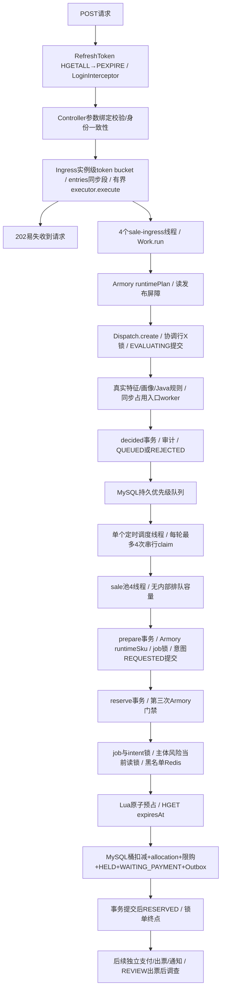

# 真实锁单全链路代码审计

本文件先于本轮业务批次生成。生产源未修改；176份Java/SQL/Lua/YAML文件的哈希及带行号SQL/事务/调度证据见 `results/full-chain-audit/source-index.json`。以下路径以 `ticket-risk-platform/src/main/` 为根；最终本轮测量另见时间线、漏斗和排序报告。代码路径存在不等于耗时已证实。

## 实际调用图和完成语义

请求分支并不相同：内存重复requestId不重复提交；持久request/alias重试不重新风控；BLOCK在库存前终止；EVALUATING租约恢复重做评估；CLAIMED租约恢复复用原reservation/order/期限；缺失Redis/版本变更安全拒绝。202不是可靠接纳或库存成功。支付/出票不是锁单终点。

## 十二个方向

|方向|确定的代码事实、方法和SQL|待测问题|
|---|---|---|
|1 HTTP|`java/com/ticketing/common/util/RefreshTokenInterceptor.preHandle` 两次同步Redis：Hash.entries与expire；`config/MvcConfig` order0刷新/order1登录；`ticket/ReservationV2Controller.create`只身份一致性及receive；`ReservationIngress.receive`1000/s实例级共享POST桶，重试也耗令牌，entries同步段内execute为AbortPolicy|鉴权两次往返占T1多少；绑定前后残余等待不直接归因Filter；entries/Bucket监视器竞争由JFR验证|
|2 入口worker|`ReservationIngress.Work.run→ReservationV2Service.submit`依次执行SQL/Redis门禁、create、风控、decided、最终get/view。4固定线程、256FIFO队列，非CallerRuns，worker忙于全部上述IO，不等sale完成|任务服务时间分布导致FIFO头阻塞多少；4线程各自的阻塞位置|
|3 特征画像|`RiskFeatureService.collect`按顺序6个hit Lua、1个payment ZCOUNT；`RiskHistorySummary.read` ready SELECT→冷缺失同步REQUIRES_NEW rebuild→再次ready；重建包含订单COUNT/SUM、近30支付、设备INSERT SELECT、summary UPSERT。末尾HSET snapshot和EXPIRE；`classifyReservation`再查3个Redis黑名单、`findBlockingAuthoritative`一条OR主体SQL；规则engine不调用Agent|新用户冷摘要必重建；同请求重复ready、摘要后台重建的成本；feature脚本实际往返；权威画像不能以陈旧PASS缓存替代|
|4 EVALUATING|`ReservationDispatch.create` RC事务：SELECT dispatch id=1 FOR UPDATE→request/alias UNION→active_owner FOR UPDATE→旧request检查→COUNT pending→guard初始化→INSERT EVALUATING→get→提交。已回退上一轮独立初始化补丁|协调等待与临界区内执行/commit分别多少；原子性及容量不能删|
|5 热点持锁|运行期协调表只有create/claim加同一主键X锁，claim更新pass_run；启动initialize INSERT ON DUP/验证。不包含库存事务，但create和claim彼此阻塞；锁直到事务提交/回滚才释放|真实等待事件区间与记录数，涉及哪些连接/请求；SQL墙钟不是纯锁等待|
|6 持久调度|`ReservationV2Service.dispatch` fixedDelay25ms，每次最多4次同步`queue.claim`，一笔claim返回后立刻submit再执行下一笔；无任务就return，没有事件唤醒。claim先协调锁，过期租约优先，COUNT CLAIMED<4，再按最老REVIEW/PASS、pass_run权重2/年龄2s选择；512 pending容量、30s期限、15s租约|实际轮间隔=上轮执行完+25ms+共享调度线程其他任务；不是每25ms可发4笔；成功/空claim、active上限、优先级各影响多少|
|7 sale|`TaskPools.execute("sale")`只由dispatch送入；固定4、queue0、拒绝后yieldClaim将lease设过去并return；无CallerRuns，不等待任务完成；`process`分别prepare/reserve或EVALUATING恢复|是否有QUEUED但sale空闲；领取时串行SQL和共享scheduler使供给不足，或确实被active_limit限制|
|8 最终事务|`ReservationV2Transactions.reserve` REQUIRES_NEW/RR：Armory共享屏障→job FOR UPDATE→intent FOR UPDATE→risk guard/profile共享当前读+3个Redis hasKey→Lua+HGET→bucket UPDATE/EXISTS SKU→allocation INSERT→quota UPSERT/条件UPDATE→HELD INSERT→order INSERT→summary event INSERT→REVIEW admission(仅REVIEW)→intent UPDATE→job UPDATE→Outbox INSERT→commit|哪些SQL/commit最慢，桶行实际有无等待，持锁期间的Redis RTT及事务剩余时间|
|9 Lua|`InventoryService.reserveRuntime` 一次库存Lua+一次HGET expiry；脚本可遍历16桶，Lua保留限购、幂等、版本fence、缺失拒绝、队列期限。feature有另6次脚本，不能混作7次库存预占；Armory每gate另有MGET/EXISTS/GET/HGETALL|命令计数、网络往返与服务端执行差，脚本缓存首次EVALSHA→EVAL加载不能错当重复扣库存|
|10 Spring事务|create/claim/decided为RC TransactionTemplate；prepare/reserve为REQUIRES_NEW RR；runtimePlan独立REQUIRED tx；runtimeSku加入调用事务。RiskHistorySummary.refresh用手动REQUIRES_NEW；Outbox MANDATORY。私有gate及Summary.rebuild自调用不是@Transactional代理边界，因为外层手动模板已建立事务|事务开始/commit开销；当前源码中确有跨MySQL事务的同步Redis网络调用，删除会破坏fence/补偿语义，需协议级设计而非直接移走|
|11 MySQL|V106唯一request/reservation/order/active_owner和alias主键；dispatch `(state,decision,created_at)`、lease `(state,lease_until)`；16桶主键(sku_id,bucket_id)，summary/guard按主体或user分片行。COUNT/EVALUATING admission、claim多个查询和结果get都是串行往返|EXPLAIN、实际digest、锁对象、IO/commit等待；小数据不能证明大规模索引充分，不能只看Hikari闲就推断数据库快|
|12 JVM/宿主|未发现自定义TaskScheduler/SchedulingConfigurer或调度池配置，运行时须验证默认单调度线程；`RiskHistorySummary.refreshPending`同一调度线程同步逐个refresh最多16个，**订单创建会写summary event**；`PlatformMetrics.refreshSnapshot`每15秒同步3组SQL，未随jobs=false关闭；Ingress.reap每秒共享调度线程。日志/采样/JFR本身有成本|线程时间线验证scheduler被后台摘要/监控占据；CPU、GC、DB容器CPU/IO、宿主同机竞争，不能把WAITING自动当CPU不足|

## 重复/等待/串行点审查

- 抢票代码没有sleep忙等；测试轮询不属于生产锁单链路。`RiskHistorySummary.refresh`同user single-flight等待`prior.get(5秒)`，不同user不因此串行；`CacheClient`睡眠、MQ等待不在此成功锁单分支。
- 两层队列分工不同：第一层易失、吸收HTTP突发；第二层持久、保存风险结论并实现全局优先级/活动领取上限/租约恢复。目前入口worker必须完成风控才能给第二层供给，第二层再被单scheduler串行claim发车；存在重复排队，但不能直接去掉其安全职责。
- `RiskHistorySummary`冷用户rebuild和后续订单事件触发的后台rebuild可在同批次出现：它们不是相同风险裁决的重复执行，但可能争用数据库并阻塞共享scheduler。
- Armory三次均保留：入场核对当前已发布计划；意图阶段把可靠恢复上下文绑定在共享版本屏障下；最终阶段把版本切换与库存/订单事务互斥。`runtimePlan`无SKU/SUM；两次`runtimeSku`各查一次静态SKU，runtimeGate每次4个Redis逻辑命令（MGET、EXISTS、GET、HGETALL）。不能只因重复就删gate。
- `SaleManifestCache.get`是实例同步方法，保护缓存解析；`entries`及令牌桶也为实例同步锁，不是全局数据库协调锁。是否构成热点待测。
- summary刷新、监控聚合及慢claim可能争同一调度线程；sale未满载并不等于sale应扩线程。

## 本轮采集设计与缺失边界（运行前）

独立 `FullChainProbe/FullChainAgent` 复制并扩展现有测试装配，外部javaagent仅诊断进程加载：统一requestId/traceId、System.nanoTime、wallMillis/nano双时钟锚点；SQL/Redis高层往返、事务begin/commit、全部成功/空claim及轮次、sale submit/start/end、其他定时任务、100ms线程状态/CPU/栈/池深度。JFR记录park/monitor/socket/GC。仅在新建owner schema/账号和原子领取空Redis DB内运行。

MySQL只读500ms采样同schema的data_lock_waits/INNODB_TRX/PROCESSLIST，尝试关联JDBC连接ID。等待关系按事务/锁ID分组；first/last只有观测时间范围，还需考虑采样查询往返误差，首次前/最后后不可见，不能伪造精确持锁时长。先读P_S consumers/instruments，未启用history则标注缺失，不改服务器配置。计划保存digest、InnoDB/log/fsync全局前后值、容器CPU/BlockIO；共享实例全局指标不能全归因这50请求。不能仅凭Java耗时区分网络与MySQL执行。

一次50/10批次，4个相同requestId重试；不预热发送抢票、不再补发另一档。成功终点必须意图COMPLETED、job RESERVED、reservation HELD、order WAITING_PAYMENT及commit返回。统计峰值/吞吐仅针对该批次，不是稳定容量。仅测试专用装配可增加采集，生产源、线程池队列、限流、DB/Redis配置不变。全部PASS时不能实验估计REVIEW公平性延迟；明确未知。

## 已有观测能力与本轮补齐

`config/BusinessMetricsAspect.measure` 已覆盖runtimePlan/runtimeSku、classify/collect、prepare/reserve及库存调用，以固定标签Micrometer Timer记录；`ReservationV2Transactions.gate`还区分sale_intent_gate/sale_reserve_gate。它们是聚合计时，不能提供同一请求的跨线程因果时间线。`RequestTimings`仅ThreadLocal并由HTTP Filter开始/结束，不自动传播到入口及sale线程；TaskPools只传播MDC，不能据此假定RequestTimings已跨线程。已有Prometheus/Grafana不改配置，本轮直接复用池Gauge/Counter及JFR，独立trace映射补异步关联、空claim、定时任务和SQL。

本轮实际采集缺口：JDBC连接ID反射getter失败，Docker stats文件没有有效记录；精确每请求InnoDB等待及容器负载不可用，没有重跑业务补数据。其余事实和统计窗口见FULL-CHAIN-TIMELINE/BOTTLENECK-RANKING；等待关系分组不是精确独立事件，观测跨度0不是等待0。MySQL waits history未启用，未改设置。
